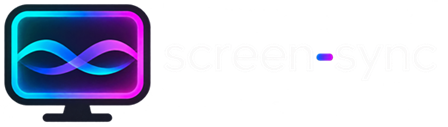

# Screen Sync

Screen Sync is a Windows desktop app for ambient lighting. It samples colors along the edges of your screen and streams them over UDP to a networked LED controller, so the light around your monitor follows what's on screen.

**[Download the latest Windows x64 installer (MSI)](https://gitlab.toxicmouse7.ru/toxicmouse7/screen-sync/-/releases/permalink/latest/downloads/screen-sync-windows-x64.msi)** · [GitLab releases](https://gitlab.toxicmouse7.ru/toxicmouse7/screen-sync/-/releases) · [Controller firmware on GitLab](https://gitlab.toxicmouse7.ru/toxicmouse7/screen-sync-hal)

## Features

- Discover controllers on the local network with mDNS or add them by IPv4 address. The device list shows their reachability.
- Save settings for multiple controllers and sync different monitors at the same time, with one active controller per monitor.
- Choose the monitor, capture band depth, and frame rate from 1 to 60 FPS for each controller.
- Configure the LED count, wiring order, and direction for each screen edge, with up to 450 LEDs per controller.
- Keep synchronization running in the Windows system tray when you close the main window.
- Use the interface in English or Russian.

## Getting started

1. Install Screen Sync and set up your LED controller using the [Screen Sync HAL firmware](https://gitlab.toxicmouse7.ru/toxicmouse7/screen-sync-hal). Connect the PC and controller to the same local network.
2. In Screen Sync, select **Add device**. Use **Automatic search** or enter the controller's IPv4 address.
3. Open the device settings, choose a monitor, and set the LED counts and wiring order to match your strip.
4. Select **Start** to begin synchronization.

## Build from source

To rebuild a published version, open its entry on the [GitLab releases page](https://gitlab.toxicmouse7.ru/toxicmouse7/screen-sync/-/releases) and download the source archive for the same release tag as the MSI.

On Windows, install Rust with `rustup` and the Visual Studio Build Tools with the **Desktop development with C++** workload and a Windows SDK. The `rust-toolchain` file selects the project's Rust version.

From the source directory, run:

```powershell
rustup target add x86_64-pc-windows-msvc
cargo build --release --locked --target x86_64-pc-windows-msvc
```

The executable is `target/x86_64-pc-windows-msvc/release/screen_sync.exe`. To package it as an MSI, run the following with [msi-builder 1.2.0](https://github.com/jkroepke/msi-builder/releases/tag/v1.2.0), replacing `X.Y.Z` with the version in `Cargo.toml`:

```powershell
msi-builder build --var "VERSION=X.Y.Z" -o screen-sync-windows-x64.msi installer.yml
```

The release pipeline's build and packaging commands are in [`.gitlab-ci.yml`](.gitlab-ci.yml).

## Roadmap

- Cross-platform support, including screen capture on macOS and Linux.

## License

Screen Sync is licensed under [LGPL-3.0-only](LICENSE). The full terms are in [COPYING.LESSER](COPYING.LESSER) and [COPYING](COPYING).
